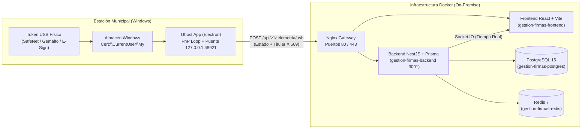

# Arquitectura del Sistema y Documentación de Módulos para Implementación Futura
**Ilustre Municipalidad de Coquimbo — Sistema de Control y Trazabilidad de Tokens FEA**

---

## 1. Alcance Actual en Producción (Fase 1: Trazabilidad y Telemetría de Tokens USB)

Por motivos de plazos de entrega institucional, el sistema opera actualmente enfocado en el **Control Patrimonial, Telemetría en Tiempo Real y Trazabilidad de Tokens Criptográficos USB**:

### 1.1. Flujo de Detección e Identificación Automática del Titular (`ghost-app`)
1. **Detección Física PnP (`Win32_PnPEntity`)**:
   - El agente silencioso de escritorio (`C:\Users\Daniel UCN\gestion-de-firmas\ghost-app\main.js`) monitorea cada `4 segundos` los puertos USB buscando dispositivos criptográficos por `VID/PID` (`0529` SafeNet/Aladdin, `08E6` Gemalto/Thales, `096E` Feitian, `1050` YubiKey, `04E6` SCM, `0A89` Athena, o clase `SmartCardReader`/`SmartCard`).
2. **Extracción Automática del Titular desde el Certificado X.509 (`Cert:\CurrentUser\My`)**:
   - Al pasar al estado `CONECTADO`, `ghost-app` ejecuta `listarCertificadosTokenWindows()`, que inspecciona el almacén de certificados de Windows (`Cert:\CurrentUser\My`) filtrando certificados con clave privada (`HasPrivateKey = true`) cuyos proveedores criptográficos o emisores correspondan a autoridades certificadoras acreditadas (`E-Sign`, `Acepta`, `E-Certchile`, ` Paperless`, `TOC`, `SafeNet`, `Thales`, `Gemalto`, `eToken`).
   - Extrae los campos del `Subject` X.509:
     - **`CN` (`titularNombre`)**: Nombre completo del funcionario titular (ej. `Ignacio Alejandro Rosales Riffo`).
     - **`E` (`titularEmail`)**: Correo institucional (ej. `irosalesr@municoquimbo.cl`).
     - **`T` (`titularCargo`)**: Cargo o título (ej. `Profesional`).
     - **`OU` (`titularUnidad`)**: Unidad / Autoridad de Registro (ej. `RA - Ilustre Municipalidad de Coquimbo`).
     - **`NotAfter` (`certNotAfter`)**: Fecha de vencimiento real del certificado del token.
     - **`SerialNumber` (`certSerialNumber`)** y **`Thumbprint` (`certThumbprint`)**.
3. **Envío de Telemetría y Persistencia**:
   - `ghost-app` envía el evento `POST /api/v1/telemetria/usb` adjuntando `metadatos` con la identidad del titular extraída del token.
   - El backend (`C:\Users\Daniel UCN\gestion-de-firmas\backend\src\telemetria\telemetria.service.ts`) persiste el evento en PostgreSQL (`telemetria_eventos.metadatosJsonb`), guarda la identidad en caché Redis (`token:cert_meta:<serialNumber>` con TTL de 30 días) y emite el evento WebSocket (`estado_pc_actualizado` y `usb-status-changed`) hacia el panel del Administrador.
4. **Visualización en el Panel de Administración (`DashboardSupervisores.tsx` y `TopHeader.tsx`)**:
   - El Administrador visualiza en tiempo real qué token físico fue insertado, en qué estación (`codigoPc` e `ipAsignada`), **a qué funcionario está asociado según su certificado X.509** (etiqueta `Titular Token USB`), sus contadores de conexiones/desconexiones y su **Promedio de Uso Diario (`hrs; mins`)**.

### 1.2. Vistas Activas en el Frontend (`C:\Users\Daniel UCN\gestion-de-firmas-frontend`)
- **Control de Tokens (`DashboardSupervisores.tsx`)**: KPIs de dispositivos existentes, activos, expirados y promedio de uso diario + tabla centralizada con búsqueda y filtros por vigencia y estado de conexión.
- **Alertas de Vencimientos (`AlertasCertificadosView.tsx`)**: Monitoreo de certificados próximos a expirar (`<= 15`, `16-30`, `31-60` días y expirados).
- **Estadísticas (`MetricasTrazabilidadPanel.tsx`)**: Serie temporal por períodos (`7d`, `15d`, `30d`, `Mensual`, `Anual` agrupado en 12 meses), tarjeta informativa de *Peso del Período*, ranking por estación, desglose por dispositivo y exportación de reporte ejecutivo PDF / LaTeX.
- **Contratos y Asignación (`GestionUsuariosEquipamientoView.tsx`)**: Gestión de contratos de adquisición de tokens y actas de custodia.
- **Bitácora de Acciones (`AuditoriaView.tsx`)**: Auditoría en 3 pestañas (`Logs Generales`, `Logs de Firmas`, `Logins y Sign Outs`) con formato estandarizado de 7 columnas (`ID / Documento`, `Persona`, `RUT Persona`, `Acción`, `Usuario`, `IP`, `Fecha y Hora`).

---

## 2. Arquitectura General del Sistema



---

## 3. Módulos Desarrollados y Preservados en Código (Ocultos para Implementación Futura)

Todo el código correspondiente a **Firma Electrónica de Documentos, Integración FirmaGob v2, Firma Criptográfica PAdES Local con Token USB, Matriz RBAC de 12 Grados, Repositorio con QR y Privacidad Ley N° 21.719** se encuentra **100% implementado y compilable** en el repositorio, habiéndose ocultado únicamente sus accesos desde el menú lateral (`Sidebar.tsx`) y el enrutador principal (`App.tsx`).

### 3.1. Firma Electrónica Criptográfica PAdES / PKCS#7 con Token USB Físico y `.p12`
- **Ubicación en Código**:
  - Agente Local (`ghost-app`): `C:\Users\Daniel UCN\gestion-de-firmas\ghost-app\main.js` (servidor HTTP local en `http://127.0.0.1:48921`).
    - `GET /status`: Estado del token y metadatos del certificado.
    - `GET /certificates`: Lista certificados X.509 con clave privada en `Cert:\CurrentUser\My`.
    - `POST /sign-digest`: Firma un hash SHA-256 (`digestHex`) en formato PKCS#7/CMS detached invocando `System.Security.Cryptography.Pkcs.SignedCms` de .NET sobre el CSP/KSP del token físico (dispara la ventana nativa de PIN de Windows/SafeNet).
  - Backend (`firmas`):
    - `C:\Users\Daniel UCN\gestion-de-firmas\backend\src\firmas\firmas.controller.ts`
    - `C:\Users\Daniel UCN\gestion-de-firmas\backend\src\firmas\firmas.service.ts`
    - Endpoints listos:
      - `POST /api/v1/firmas/pades/preparar`: Incrusta la estampa visual tipo Adobe + código QR verificable + diccionario `/ByteRange` placeholder y devuelve el hash SHA-256 a firmar.
      - `POST /api/v1/firmas/pades/completar`: Inyecta el contenedor PKCS#7/CMS devuelto por el token físico dentro del `/Contents` hexadecimal del PDF, generando un PDF con firma PAdES válida en Adobe Acrobat Reader, y lo guarda en el repositorio institucional.
      - `POST /api/v1/firmas/estampar-pdf`: Firma PAdES directa utilizando un certificado `.p12` de prueba autogenerado (`obtenerCertificadoP12Prueba`) cuando se selecciona modo de prueba local.
  - Frontend:
    - `C:\Users\Daniel UCN\gestion-de-firmas-frontend\src\components\VistaFirmaUsuario.tsx`
    - `C:\Users\Daniel UCN\gestion-de-firmas-frontend\src\components\VisorFirmaAdobe.tsx`

### 3.2. Integración API FirmaGob v2 (Etapa A Desatendida y Etapa B con OTP)
- **Ubicación en Código**:
  - `C:\Users\Daniel UCN\gestion-de-firmas\backend\src\firmas\firmagob.service.ts`
  - `C:\Users\Daniel UCN\gestion-de-firmas\backend\src\firmas\firmas.service.ts` (`firmarDocumentoConFirmaGobV2`)
- **Características implementadas**:
  - Generación automática de token JWT HS256 con claims oficiales (`entity`, `run`, `expiration`, `purpose`) según manual técnico FirmaGob v18.
  - Pre-estampado visual del PDF con opción `soloEstampaVisual: true` para evitar colisión de diccionarios `/ByteRange` previos en el parser de `api.firma.cert.digital.gob.cl`.
  - Soporte para **Propósito Desatendido** (`Desatendido`, Etapa A sin OTP) y **Propósito Propósito General** (Etapa B con cabezal `OTP`).

### 3.3. Matriz RBAC Jerárquica Municipal (12 Grados)
- **Ubicación en Código**:
  - Backend: `C:\Users\Daniel UCN\gestion-de-firmas\backend\src\auth\rbac-firmas.policy.ts`
  - Frontend: `C:\Users\Daniel UCN\gestion-de-firmas-frontend\src\lib\rbacFirmas.ts`
- **Características implementadas**:
  - Clasificación jerárquica desde Grado 1 (`ALCALDE`) hasta Grado 12 (`FUNCIONARIO`), determinando tipos de documentos permitidos, requerimiento de Fe Pública (`SECRETARIO_MUNICIPAL`), visación jurídica/control y nivel de sensibilidad máximo.

### 3.4. Repositorio de Documentos Firmados, QR Público (`/validar`) y Privacidad Ley N° 21.719
- **Ubicación en Código**:
  - Backend:
    - `GET /api/v1/firmas/repositorio`: Lista metadatos de documentos firmados (filtrable por `rutTitular`).
    - `GET /api/v1/firmas/repositorio/:codigo/pdf`: Descarga/visualización del PDF firmado **restringida exclusivamente al titular firmante** mediante validación de JWT (`verificarAccesoTitularDocumento`), bloqueando el acceso al contenido documental por parte de terceros o administradores en cumplimiento de los principios de **Minimización de Datos, Finalidad y Confidencialidad de la Ley N° 21.719** (Protección de Datos Personales en Chile).
    - `GET /api/v1/firmas/repositorio/:codigo/validar`: Endpoint público para el código QR que expone únicamente metadatos de autenticidad e integridad (`SHA-256`, firmante, fecha, validez) sin exponer el contenido del PDF a terceros no autenticados.
  - Frontend:
    - `C:\Users\Daniel UCN\gestion-de-firmas-frontend\src\components\RepositorioDocumentosView.tsx`
    - `C:\Users\Daniel UCN\gestion-de-firmas-frontend\src\components\ValidadorDocumentoView.tsx` (activo en la ruta pública `/validar?codigo=...`).

---

## 4. Guía Rápida para Reactivar los Módulos Ocultos en el Futuro

Para volver a habilitar las vistas de firma de documentos y repositorio en el frontend sin escribir código nuevo:

1. **En `C:\Users\Daniel UCN\gestion-de-firmas-frontend\src\components\Sidebar.tsx`**:
   Agregar nuevamente los ítems `'FIRMAR'` (`Firmar Documento`) y `'DOCUMENTOS'` (`Documentos Firmados`) al arreglo `itemsControlTokens`.
2. **En `C:\Users\Daniel UCN\gestion-de-firmas-frontend\src\App.tsx`**:
   - Volver a incluir las líneas en el bloque `<main>`:
     ```tsx
     {tabActiva === 'FIRMAR' && <VistaFirmaUsuario />}
     {tabActiva === 'DOCUMENTOS' && <RepositorioDocumentosView soloTitular rutTitular={usuario?.rut} />}
     ```
   - Si se desea vista separada para el rol `FUNCIONARIO`, descomentar/restaurar la condición `if (!esSupervisorOAdmin)` que renderiza `<VistaFirmaUsuario />` y `<RepositorioDocumentosView soloTitular rutTitular={usuario?.rut} />`.
3. **En `C:\Users\Daniel UCN\gestion-de-firmas-frontend\src\components\DashboardSupervisores.tsx`** (opcional):
   - Si se desea volver a mostrar las columnas `Firmas Período` y `Firmas Totales`, están disponibles en el objeto `metricas.accionesFuncionarios` del store `useTelemetriaStore.ts`.
